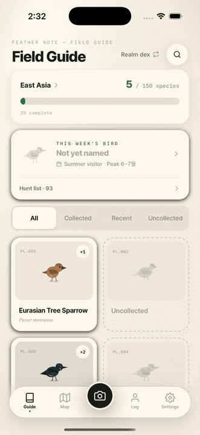
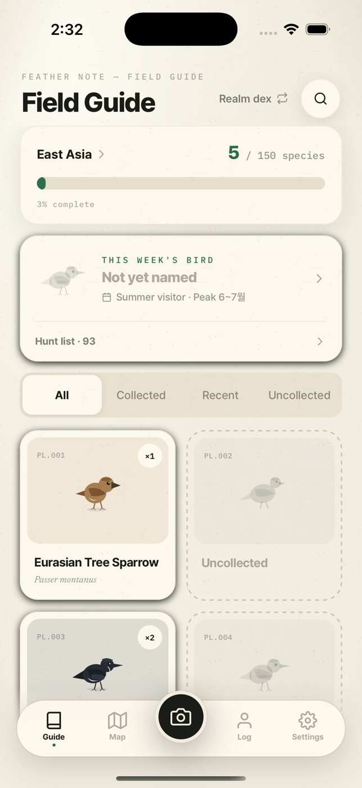
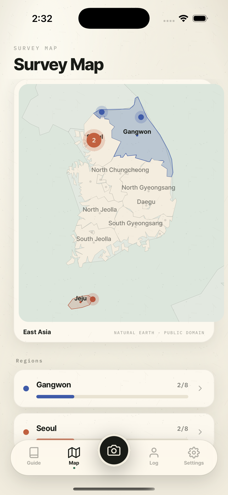
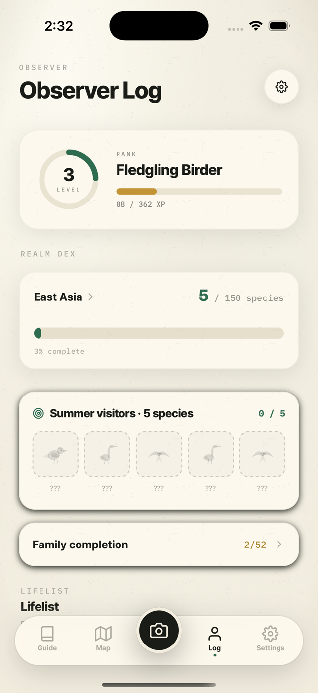
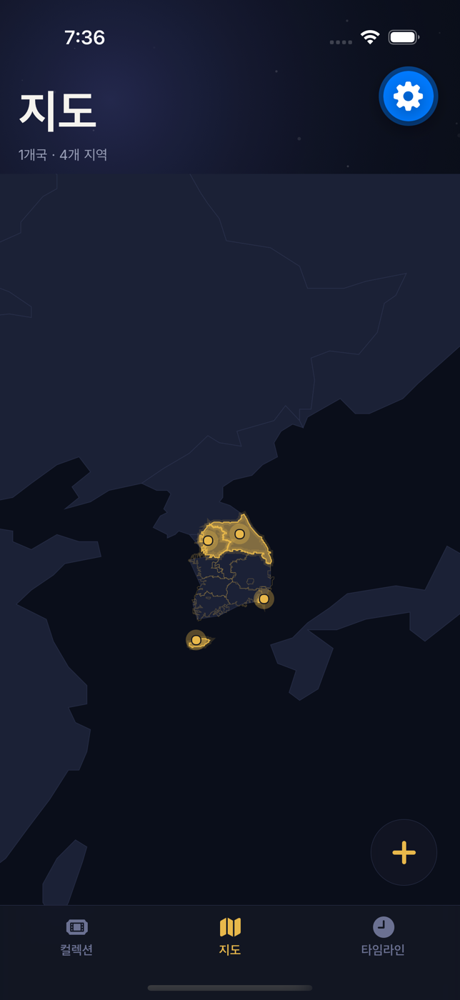
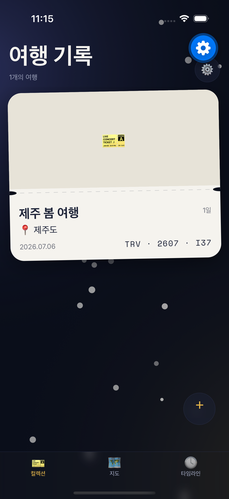
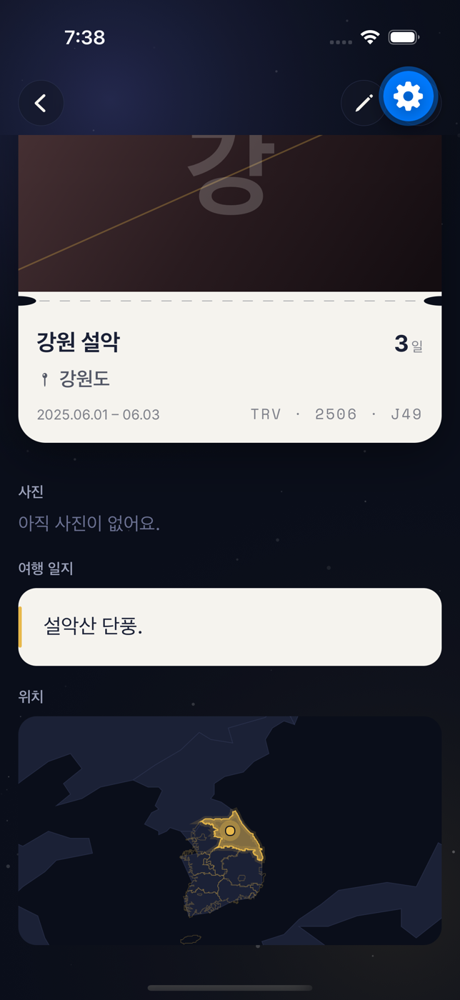

[English](README.md) · **한국어** · [简体中文](README.zh-CN.md) · [日本語](README.ja.md)

<p align="center">
  
</p>
<p align="center">
  <b>아이디어에서 출시 가능한 iOS + Android 앱 또는 게임까지 — Expo(React Native + TypeScript) 기반의 회의적 QA AI 하네스.</b>
</p>

<p align="center">
  
  
  
  
  
  
</p>

## 이게 뭔가요

Expo Launchpad는 아이디어를 *플레이 가능한* iOS + Android 앱 **또는** 게임으로 만들어내는
Claude Code 플러그인입니다. 게이트가 걸린 단계별로 기획하고 빌드한 뒤, 회의적인 evaluator가
시뮬레이터에서 앱을 실행하고 스크린샷을 살펴본 후에야 "완료"라고 말합니다.

<details><summary>목차</summary>

- [주요 기능](#주요-기능)
- [데모](#데모)
- [빠른 시작](#빠른-시작)
- [동작 방식](#동작-방식)
- [플래그](#플래그)
- [생성되는 스택](#생성되는-스택)
- [요구 사항](#요구-사항)
- [왜 Expo Launchpad인가요?](#왜-expo-launchpad인가요)
- [자주 묻는 질문](#자주-묻는-질문)
- [로드맵](#로드맵)
- [후원](#후원)
- [기여하기](#기여하기)
- [크레딧 및 라이선스](#크레딧-및-라이선스)
</details>

## 주요 기능

- 💡 아이디어 → 플레이 가능한 결과물 파이프라인 — 코드 한 줄이 생성되기 전에 research, plan, design, contract 과정을 거칩니다.
- 📱🎮 하나의 하네스로 앱 **그리고** 게임을 모두 (`--kind`).
- 🕵️ 회의적인 QA — evaluator가 실제 시뮬레이터에서 앱을 실행하고 스크린샷을 살펴봅니다; 스텁(stub)이 발견되면 자동으로 실패 처리됩니다.
- ✅ 8개의 hard gate에 더해 R1–R11 플랫폼 견고성 게이트(오디오, 라이프사이클, 접근성 등)까지.
- 🔋 내구성 있는 저장, 다국어 지원(i18n), 접근성이 첫 생성 커밋부터 기본 탑재됩니다.
- 🎨 두 가지 렌더링 경로 — 앱은 Expo Router, 게임은 Skia.

## 데모

<p align="center">
  
</p>

아래 두 앱 모두 이 하네스가 만들었습니다 — 아이디어 → 리서치 → PRD → 디자인 토큰 → 계약 →
코드 생성 → 시뮬레이터에서 도는 회의적 평가자. 손으로 디자인한 화면은 하나도 없습니다.

**깃털노트(Feather Note)** — 탐조 도감 앱(`--kind app`). 오프라인 도감, 지역별 채집 지도, AI 종 판별.

<p align="center">
  
  
  
</p>

**Grainatlas** — 여행 기록 앱(`--kind app`, 한국어). 단계 색상 여행 지도, 타임라인, 오프라인 전용 저장.

<p align="center">
  
  
  
</p>

## 빠른 시작

```text
# in Claude Code
/plugin marketplace add https://github.com/SummerRiversound/expo-launchpad
/plugin install expo-launchpad

/expo-launchpad --kind app  "a habit tracker with streaks"
/expo-launchpad --kind game "a one-tap endless runner"
```

## 동작 방식

<p align="center"></p>

| 단계 | 하는 일 |
|---|---|
| research | 시장/장르를 조사하거나, 아이디어가 주어지면 클론-폴백을 확인합니다. |
| plan | PRD를 작성하고 아이덴티티(`app_name`, `app_slug`, `bundle_id`)를 고정합니다. |
| design | 디자인 토큰과 비주얼 스펙을 만듭니다. |
| contract | hard gate와 functional criteria를 협의합니다; `AGREED` 상태가 되기 전까지 generator는 시작하지 않습니다. |
| generator | 게이트가 걸린 서브 단계로 앱을 빌드합니다. |
| evaluator | 시뮬레이터에서 앱을 실행하고, 핵심 플로우를 조작하고, 스크린샷을 살펴본 뒤 판정합니다. |
| human-review | 실행이 완료되기 전, 사람이 PASS를 검토할 때까지 대기합니다. |

generator는 게이트가 걸린 3개의 서브 단계(`6a` → `6b` → `6c`)로 빌드하며, 각 단계는
`tsc --noEmit` + `expo lint` + `jest`로 게이트됩니다. FAIL이 나오면 evaluator는 실행을 다음
라운드로 돌려보냅니다.

## 플래그

| 플래그 | 기본값 | 의미 |
|---|---|---|
| `--kind app\|game` | `app` | 무엇을 만들지. |
| `--engine skia` | `skia` | 렌더 엔진(게임 전용). |
| `--strict` | off | evaluator에 품질 스코어링과 엣지 케이스 스윕을 추가합니다. |
| `--rounds N` | `3` | 강제 판정 전까지의 generator ⇄ evaluator 최대 라운드 수. |
| `--skip-research` | off | research를 건너뜁니다; 빌드할 아이디어가 필수입니다. |
| `--auto-idea` | off | 사용자에게 묻는 대신 research가 추천한 컨셉을 자동으로 선택합니다. |
| `--auto-deploy` | off | evaluator의 PASS 처리 방식이 달라집니다. |
| `--resume` | — | 중단된 실행을 이어서 진행합니다. |

읽기 전용 동반 리포터: `/expo-launchpad-status` — 단계, 라운드, 다음 역할, 중단 사유.

## 생성되는 스택

| 도구 | 역할 |
|---|---|
| Expo Router | 앱 내비게이션 (`kind: app`) |
| TypeScript (strict) | 언어 |
| Jest (`jest-expo`) + `@testing-library/react-native` | 유닛·컴포넌트 테스트 |
| Maestro | E2E 플로우 검증 |
| `@shopify/react-native-skia` | 게임 렌더링 (`kind: game`) |
| `expo-audio` / `expo-haptics` / `expo-secure-store` / `expo-localization` / `expo-screen-orientation` | 오디오, 햅틱, 보안 저장소, 다국어 지원, 화면 방향 |

## 요구 사항

- Claude Code
- macOS + Xcode iOS 시뮬레이터 — evaluator가 `npx expo run:ios`로 빌드를 판정합니다
- Node
- Maestro(선택) — E2E 플로우 검증에 사용됩니다

## 왜 Expo Launchpad인가요?

| | `create-expo-app` | 직접 작업 | **Expo Launchpad** |
|---|:---:|:---:|:---:|
| 프로젝트 스캐폴딩 | ✅ | ➖ | ✅ |
| 시장/클론 리서치 | ➖ | ➖ | ✅ |
| 코드 이전 PRD + 디자인 + contract | ➖ | ➖ | ✅ |
| 앱 실행 & 판정(회의적 QA) | ➖ | 수동 | ✅ |
| 견고성 게이트(오디오, 라이프사이클, 접근성, 내구성 저장) | ➖ | 수동 | ✅ |
| 앱 **그리고** 게임 | 앱만 | 둘 다 | ✅ |

## 자주 묻는 질문

**정말로 지금 동작하나요?**
솔직히 말하면: **alpha** 단계입니다. 전체 파이프라인은 구현되어 있고 자체 검증도 통과하며, 위
[데모](#데모)의 두 앱을 실제로 만들어냈습니다. 아직 해내지 못한 건 앱을 스토어 출시까지 끌고 가는
일입니다. 직접 사용해보고 이슈를 남겨주세요 — 그런 피드백이 지금 가장 필요합니다.

**왜 Expo인가요?**
하나의 TypeScript 코드베이스로 iOS + Android를 모두 커버하고, evaluator가 다룰 수 있는 빠른
시뮬레이터 루프를 제공합니다.

**앱인가요, 게임인가요?**
둘 다입니다 — `--kind app`은 Expo Router를, `--kind game`은 Skia 렌더 루프를 사용합니다.

**Phase B는 뭔가요?**
배포: EAS Build/Submit, 스토어 스크린샷/메타데이터, 광고 — 계획만 되어 있고 아직 구현되지
않았습니다.

**Mac이 꼭 필요한가요?**
evaluator의 시뮬레이터 실행에는 필요합니다(`npx expo run:ios`는 Xcode를 필요로 합니다).

## 로드맵

- [x] Phase A — 아이디어 → 플레이 가능한 결과물 (이번 릴리스)
- [ ] Phase B — EAS build/submit, 스토어 에셋, 광고

## 후원

Expo Launchpad가 시간을 아껴줬다면 [커피 한 잔](https://ko-fi.com/riversound) ☕ 사주세요 — 프로젝트를 계속 이어가는 데 큰 힘이 됩니다. 감사합니다!

<a href="https://ko-fi.com/riversound"></a>

## 기여하기

기여를 환영합니다 — [CONTRIBUTING.md](CONTRIBUTING.md)와 [SECURITY.md](SECURITY.md)를 참고하세요.
PR을 열기 전에 `bash scripts/validate.sh`가 통과해야 합니다.

## 크레딧 및 라이선스

MIT — [LICENSE](LICENSE)를 참고하세요. [`flutter-flame-harness`](https://github.com/tjdrhs90/flutter-flame-harness)(MIT, tjdrhs90 저작)를
구조적으로 포팅한 것입니다 — 자세한 내용은 [NOTICE](NOTICE)를 참고하세요.

<p align="center">⭐ 이 프로젝트가 유용하다면 <b>Star</b>를 눌러주세요 — 다른 사람들이 찾는 데 도움이 됩니다.</p>
