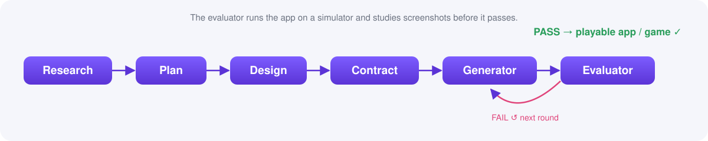

**English** · [한국어](README.ko.md) · [简体中文](README.zh-CN.md) · [日本語](README.ja.md)

<p align="center">
  
</p>
<p align="center">
  <b>From idea to a shippable iOS + Android app or game — a skeptical-QA AI harness built on Expo (React Native + TypeScript).</b>
</p>

<p align="center">
  
  
  
  
  
  
  <a href="https://ko-fi.com/riversound"></a>
</p>

## What is this

Expo Launchpad is a Claude Code plugin that drives an idea into a *playable* iOS + Android app **or**
game. It plans and builds in gated phases, then runs a skeptical evaluator that launches the app on
a simulator and studies screenshots before it ever says "done."

<details><summary>Table of contents</summary>

- [Features](#features)
- [Demo](#demo)
- [Quickstart](#quickstart)
- [How it works](#how-it-works)
- [Flags](#flags)
- [Generated stack](#generated-stack)
- [Requirements](#requirements)
- [Why Expo Launchpad?](#why-expo-launchpad)
- [FAQ](#faq)
- [Roadmap](#roadmap)
- [Support](#support)
- [Contributing](#contributing)
- [Credits & License](#credits--license)
</details>

## Features

- 💡 Idea → playable pipeline — research, plan, design, and contract before a line of code is generated.
- 📱🎮 Apps **and** games from the same harness (`--kind`).
- 🕵️ Skeptical QA — the evaluator runs the app on a real simulator and studies screenshots; a detected stub is an automatic fail.
- ✅ 8 hard gates plus R1–R11 platform-robustness gates (audio, lifecycle, accessibility, and more).
- 🔋 Durable save, i18n, and accessibility baked in from the first generated commit.
- 🎨 Two render paths — Expo Router for apps, Skia for games.

## Demo

> 🚧 A recorded demo (idea → running app on a simulator) is coming soon. For now, see [How it works](#how-it-works).

## Quickstart

```text
# in Claude Code
/plugin marketplace add https://github.com/SummerRiversound/expo-launchpad
/plugin install expo-launchpad

/expo-launchpad --kind app  "a habit tracker with streaks"
/expo-launchpad --kind game "a one-tap endless runner"
```

## How it works

<p align="center"></p>

| Phase | What it does |
|---|---|
| research | Scans the market/genre, or checks a clone-fallback when an idea is given. |
| plan | Writes the PRD and locks identity (`app_name`, `app_slug`, `bundle_id`). |
| design | Produces the design tokens and visual spec. |
| contract | Negotiates the hard gates and functional criteria; the generator won't start until it's `AGREED`. |
| generator | Builds the app in gated sub-phases. |
| evaluator | Runs the app on a simulator, drives the core flow, and studies screenshots before judging. |
| human-review | Pauses for a human to review a PASS before the run completes. |

The generator builds in 3 gated sub-phases (`6a` → `6b` → `6c`), each gated by `tsc --noEmit` +
`expo lint` + `jest`. On a FAIL, the evaluator sends the run back for another round.

## Flags

| Flag | Default | Meaning |
|---|---|---|
| `--kind app\|game` | `app` | What to build. |
| `--engine skia` | `skia` | Render engine (game only). |
| `--strict` | off | Adds quality scoring and an edge-case sweep to the evaluator. |
| `--rounds N` | `3` | Max generator ⇄ evaluator rounds before a forced judgment. |
| `--skip-research` | off | Skips research; requires an idea to build from. |
| `--auto-idea` | off | Auto-picks a research-recommended concept instead of asking. |
| `--auto-deploy` | off | Changes how an evaluator PASS resolves. |
| `--resume` | — | Continues a paused run. |

Companion read-only reporter: `/expo-launchpad-status` — phase, round, next role, pause reason.

## Generated stack

| Tool | Role |
|---|---|
| Expo Router | App navigation (`kind: app`) |
| TypeScript (strict) | Language |
| Jest (`jest-expo`) + `@testing-library/react-native` | Unit and component tests |
| Maestro | E2E flow checks |
| `@shopify/react-native-skia` | Game rendering (`kind: game`) |
| `expo-audio` / `expo-haptics` / `expo-secure-store` / `expo-localization` / `expo-screen-orientation` | Audio, haptics, secure storage, i18n, orientation |

## Requirements

- Claude Code
- macOS + Xcode iOS Simulator — the evaluator runs `npx expo run:ios` to judge the build
- Node
- Maestro (optional) — powers the E2E flow checks

## Why Expo Launchpad?

| | `create-expo-app` | By hand | **Expo Launchpad** |
|---|:---:|:---:|:---:|
| Scaffolds a project | ✅ | ➖ | ✅ |
| Market/clone research | ➖ | ➖ | ✅ |
| PRD + design + contract before code | ➖ | ➖ | ✅ |
| Runs the app & judges it (skeptical QA) | ➖ | manual | ✅ |
| Robustness gates (audio, lifecycle, a11y, durable save) | ➖ | manual | ✅ |
| Apps **and** games | app | either | ✅ |

## FAQ

**Does it really work yet?**
Honestly: it's **alpha**. The full pipeline is built and self-validates, but it has not yet been run
end-to-end to a shipped app. Try it and file issues — that feedback is exactly what it needs.

**Why Expo?**
One TypeScript codebase → iOS + Android, with a fast simulator loop the evaluator can drive.

**App or game?**
Both — `--kind app` uses Expo Router; `--kind game` uses a Skia render loop.

**What's Phase B?**
Deploy: EAS Build/Submit, store screenshots/metadata, ads — planned, not built.

**Do I need a Mac?**
Yes for the evaluator's simulator run (`npx expo run:ios` needs Xcode).

## Roadmap

- [x] Phase A — idea → playable (this release)
- [ ] Phase B — EAS build/submit, store assets, ads
- [ ] Recorded demo + example app

## Support

If Expo Launchpad saves you time, you can [buy me a coffee](https://ko-fi.com/riversound) ☕ — it helps keep the project moving. Thank you!

<a href="https://ko-fi.com/riversound"></a>

## Contributing

Contributions are welcome — see [CONTRIBUTING.md](CONTRIBUTING.md) and [SECURITY.md](SECURITY.md).
`bash scripts/validate.sh` must pass before opening a PR.

## Credits & License

MIT — see [LICENSE](LICENSE). A structural port of
[`flutter-flame-harness`](https://github.com/tjdrhs90/flutter-flame-harness) (MIT) by tjdrhs90 —
see [NOTICE](NOTICE).

<p align="center">⭐ <b>Star it</b> if this is useful — it helps others find it.</p>
